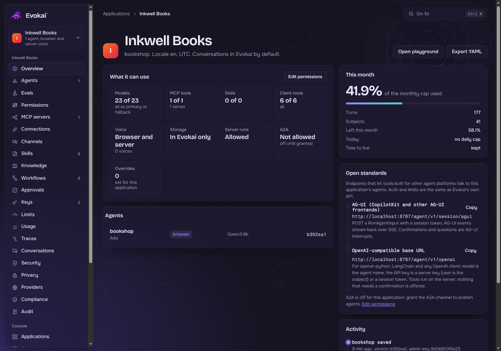
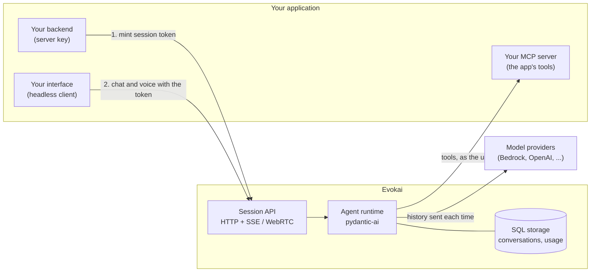

<div align="center">


# Evokai™

**Summon AI agents into any app, with the governance a company needs.**<br/>
Any model, from the big clouds to your own servers; your app's tools over MCP, skills and voice; always acting as the
signed-in user, within budgets, with an audit trail.

[](https://github.com/Giordyfish/evokai/actions/workflows/ci.yml)
[](#status)
[](LICENSE)
[](pyproject.toml)

[Quick start](#quick-start) · [Examples](examples) · [Features](#features) · [How it works](#how-it-works) · [Client](#the-typescript-client) · [Docs](#documentation) · [Contributing](#contributing)

</div>

<p align="center"></p>

Your backend mints a short session token for the signed-in user; the page talks to the agent with it:

```ts
// Your backend, with the server key
import { EvokaiServer } from '@evokai/evokai-client/server'

const evokai = new EvokaiServer({ baseUrl: process.env.EVOKAI_URL!, serverKey: process.env.EVOKAI_SERVER_KEY! })
app.post('/api/agent/token', async (req, res) => res.json(await evokai.mintSessionToken({ subject: req.user.id, agent: 'assistant' })))
```

```html
<!-- Your page: a launcher and a chat panel, with voice -->
<evokai-chat base-url="http://localhost:8787/agent" token-url="/api/agent/token" title="Ada"></evokai-chat>
```

The agent calls your app's tools over MCP as that user, asks before it changes anything, and stays within the budgets
you set. A complete app is in [examples/bookshop-app](examples/bookshop-app).

---

## Why Evokai

Every product ends up wanting an assistant that can *do things*: read the data on screen, run the app's own
actions, answer by voice, and never step outside what the user is allowed to do. Building that once per product
means rewriting the same hard parts each time: the tool loop, confirmations, budgets, history, voice turn-taking.

Evokai is that layer, written once. An application connects with a key, describes its agents in a YAML file, and
its users talk to them through a small headless client. The application keeps its identity, its data and its
interface; Evokai brings the agents.

### Any model, cloud or self-hosted

One allow-list for every provider [pydantic-ai](https://ai.pydantic.dev) speaks: Amazon Bedrock, Azure OpenAI,
Google Vertex AI, OpenAI, Anthropic, Mistral, Groq, OpenRouter and European clouds (Scaleway, OVHcloud, IONOS,
STACKIT), or models on your own hardware through Ollama, vLLM, LM Studio or any OpenAI-compatible server. Each agent
has an ordered fallback chain, so a provider without capacity, or one a policy rules out, is skipped rather than
failing the turn. Changing model is a line of configuration, not a new integration.

### Governance for companies

Bringing AI into a company is less about the model than about control. In Evokai every application is granted what
its agents may use (models, tools, skills, voice, channels, code execution), each with its own keys and caps;
people only ever act as themselves; tools that change data wait for a confirmation; every console change lands in an
audit log, behind single sign-on with viewer, operator and owner roles. A security layer screens prompts, tool output
and answers (mapped to the OWASP LLM Top 10), and evals catch a regression before a new agent version goes live.

### Made for AI products in Europe

Evokai is meant to enable AI products, and it pays particular attention to the European regulatory space. Each
application declares where its data may live and which inference geographies its models may use (**data residency**),
which countries may control the providers that process it (**jurisdiction**) and what those providers may keep
(**retention**: any, no training, or zero retention). This **data protection profile** applies to every external
processor alike (models, embeddings, classifiers, the code sandbox, server speech, connections), and a provider the
catalog cannot prove compliant is left out: see [data protection](docs/data-protection.md). Privacy requests, retention
per kind of data, and AI Act and GDPR packs generated from the live configuration build on the same facts.

## Status

Evokai is **experimental** and early-stage. Interfaces (the HTTP API, the configuration, the clients) may change
between 0.x releases, and a release may need a manual migration step; read the [changelog](CHANGELOG.md) before you
upgrade. Using it in production is at your own risk: the software is provided "as is", without warranties or
conditions of any kind, and without liability, as stated in sections 7 and 8 of the [Apache License 2.0](LICENSE).

## Features

- **Any model, cloud or self-hosted**: Bedrock, Azure, Vertex, OpenAI, Anthropic, Mistral, European clouds, or your
  own servers (Ollama, vLLM, LM Studio), behind an allow-list, with fallbacks when a model has no capacity.
- **Your tools over MCP**, called as the signed-in user; tools that change data wait for the user's confirmation.
- **Skills, knowledge bases and ready connectors** (SQL, REST from OpenAPI, Google Drive, SharePoint, IMAP).
- **Voice**: dictation, conversation and barge-in, in the browser or on the server with [Pipecat](https://pipecat.ai).
- **Budgets** per application and per user, enforced before every model call; people see shares, never amounts.
- **An agent security layer** mapped to the OWASP LLM Top 10: injection checks, personal data masked, a tool policy.
- **Privacy and compliance**: data residency, export and erasure, retention, and AI Act and GDPR packs generated from
  the live configuration.
- **Open standards**: [AG-UI](docs/ag-ui.md), an [OpenAI-compatible API](docs/openai-compatible.md) and [A2A](docs/a2a.md).
- **An admin console** for applications, agents and their versions, grants, keys, limits, evals and a playground.

The whole list, with details: [features](docs/features.md).

## How it works



1. Your backend holds the **server key** and mints a short-lived **session token** for one of its users (an opaque
   `subject`) and an agent.
2. The browser talks to Evokai directly with that token: text over SSE, voice in the browser or over WebRTC.
3. Each turn runs the agent: model calls with fallbacks, your tools through MCP with the user's own credential,
   confirmations, budgets. Events stream back numbered, so a reconnecting client replays what it missed.

## Quick start

Five minutes, with Docker and nothing else ([the whole walk-through](docs/quickstart.md)):

```bash
git clone https://github.com/Giordyfish/evokai && cd evokai
docker compose up -d --build     # Evokai, its console and its own Postgres; keys generated on first start
docker compose logs evokai       # the console address and the operator key, printed once
```

Open `http://localhost:8787/agent/admin/`, enter the operator key, and the console's setup creates your first
application, its agent (a model from the allowed list, its instructions, optionally your MCP server, tested before it
is saved, and skills) and its server key. No YAML. The test model works with no account; pass `OPENAI_API_KEY`,
`MISTRAL_API_KEY`, AWS credentials or `OLLAMA_BASE_URL` for a real one.

From the source tree:

```bash
uv sync --all-extras --dev
uv run evokai migrate
EVOKAI_CONFIG_FILE=config/bookshop.yaml uv run evokai serve   # an example bookshop back office; /agent/health
```

For infrastructure as code, an application is a YAML file applied at start:

```yaml
application:
  slug: acme
  name: Acme
  server_key: "${EVOKAI_ACME_SERVER_KEY}"
  allowed_origins: ["https://app.acme.example"]
  allowed_models: ["bedrock:eu.*"]
  monthly_cap_usd: 20
  subject_daily_usd: 0.5
  conversation_ttl_days: 7

mcp_servers:
  - name: acme
    url: "https://app.acme.example/api/mcp"
    auth: forward_user

agents:
  - name: assistant
    model: eu.anthropic.claude-haiku-4-5-20251001-v1:0
    fallbacks: [eu.anthropic.claude-sonnet-4-6]
    mcp_servers: [acme]
    instructions: |
      You are Acme's assistant. Use the tools; never invent data.
```

## The TypeScript client

[`@evokai/evokai-client`](clients/typescript) is headless: it gives your interface everything it needs and draws
nothing.

```ts
// Backend: mint a token for the signed-in user
import { EvokaiServer } from '@evokai/evokai-client/server'

const evokai = new EvokaiServer({ baseUrl: process.env.EVOKAI_URL!, serverKey: process.env.EVOKAI_SERVER_KEY! })
const token = await evokai.mintSessionToken({ subject: user.id, agent: 'assistant', forwardCredential: user.accessToken })
```

```ts
// Browser: chat, events and voice
import { EvokaiSession, createVoiceEngine } from '@evokai/evokai-client/browser'

const session = new EvokaiSession({
  baseUrl: 'https://agents.example.com/agent',
  getToken: ({ conversationId }) =>
    fetch('/api/agent/token', { method: 'POST', body: JSON.stringify({ conversationId }) }).then((r) => r.json()),
})
session.on('text', (e) => appendToAnswer(e.delta))
session.on('chart', (e) => drawChart(e.chart))
session.on('confirm', (e) => askTheUser(e.actionId, e.items))
session.on('usage', (u) => showShare(u.dayPct))
await session.chat({ text: 'How did October go?' })

const voice = createVoiceEngine(session, { micSound: 'goccia' }) // dictation, conversation, barge-in
```

| Entry point | Runs in | What it gives you |
| --- | --- | --- |
| `/server` | your backend | session tokens, conversations, usage, server runs, admin API |
| `/browser` | any web app | session and typed events, turn phases, microphone, voice modes, speech engines, audio signals |
| `/react` | React 18+ | thin hooks over `/browser` |

Every export and event is in [API.md](clients/typescript/API.md).

### Ready-made interface

[`@evokai/evokai-ui`](clients/ui) draws it for you: `<evokai-chat>` (a launcher orb and a chat panel with Markdown,
tool activity, charts, questions, confirmations, usage shares, history, feedback, dictation and voice mode) and
`<evokai-voice>` (a full-screen voice stage), as Web Components with React wrappers, themable with CSS custom
properties, in English and Italian.

```html
<evokai-chat base-url="https://agents.example.com/agent" token-url="/api/agent/token" title="Ada"></evokai-chat>
```

## Documentation

| Guide | What is in it |
| --- | --- |
| [Quick start](docs/quickstart.md) | Docker Compose, the first-run setup in the console, models |
| [Features](docs/features.md) | Everything Evokai does, in one table |
| [Knowledge bases](docs/knowledge.md) | Documents agents search (PDF, Office, HTML, Markdown, CSV), hybrid search with pgvector, access groups, citations |
| [Evals](docs/evals.md) | Test cases per agent, runs on save and on demand, the comparison, the eval budget |
| [Connectors](docs/connectors/README.md) | Ready MCP servers: SQL, REST/OpenAPI, Google Drive, SharePoint and OneDrive, IMAP |
| [Architecture](docs/architecture.md) | Concepts, the protocol, voice, limits, storage and the hard rules |
| [Configuration](docs/configuration.md) | Environment variables, application YAML, bootstrap, keys, time to live |
| [Deployment](docs/deployment.md) | Running it, Docker, database setup, CI gates, images, SBOMs and signing |
| [Security](docs/security.md) | Threat model, the security layer's controls (OWASP LLM Top 10), configuration, events |
| [Data protection](docs/data-protection.md) | The data protection profile: residency, jurisdiction and retention rules for every processor, and the provider catalog |
| [Privacy](docs/privacy.md) | What is stored, where, for how long; export and erase; residency; sub-processors |
| [Compliance](docs/compliance.md) | AI Act, GDPR and ISO 27001 / SOC 2 packs generated from the configuration, with sources, snapshots and diffs |
| [Code execution](docs/code.md) | `code_run`: Python in Amazon Bedrock AgentCore Code Interpreter, isolated, EU region, off until granted |
| [Security assessment](docs/security-assessment.md) | The review of the browser session API, its findings and fixes |
| [AG-UI](docs/ag-ui.md) | The AG-UI endpoint for CopilotKit and other AG-UI frontends; confirmations as interrupts |
| [OpenAI-compatible API](docs/openai-compatible.md) | Chat Completions for openai-python, LangChain and any OpenAI client |
| [A2A](docs/a2a.md) | Agent Cards and JSON-RPC for other agents, off until granted |
| [Client](clients/typescript/README.md) | Installing and using `@evokai/evokai-client` |
| [Python SDK](clients/python/README.md) | The `evokai-client` package (`import evokai`): server SDK, admin, session client with typed events |
| [Releasing](docs/releasing.md) | How a version is tagged and published, and the one-time setup of the registries |

## Project layout

```text
src/evokai/        the service: api, agents, sessions, mcp, llm, tools, audio, identity, db, observability
migrations/        Alembic migrations, portable across SQL databases
clients/typescript the headless client (@evokai/evokai-client)
clients/python     the Python SDK (evokai): server, admin and session clients, sync and async
clients/ui         the embeddable interface (@evokai/evokai-ui): <evokai-chat>, <evokai-voice>, React wrappers
admin/             the admin console (static app served at {base}/admin/)
config/            an example application (a fictional bookshop) with a skill
examples/          a complete app that summons its agent (backend, page, tools)
docs/              architecture, configuration, deployment
scripts/           ci.sh (all gates) and build-image.sh
tests/             pytest, with fake models, MCP servers and speech
```

## Development

```bash
scripts/ci.sh      # ruff, ty, pytest, OpenAPI check, the client, the UI components and the admin console
scripts/quickstart-smoke.sh   # the Docker quick start end to end, as CI runs it
scripts/record-cassettes.sh mcp|bedrock   # opt-in: record the HTTP cassettes the suite replays
```

Tests replay recorded HTTP cassettes and never reach the network
([recorded HTTP cassettes](docs/deployment.md#recorded-http-cassettes)).

## Contributing

This repository is developed with heavy use of AI agents. Work however you like, by hand or with agents: nobody is
asked to use AI, and nobody is asked to avoid it. Complaining that the project is built with AI is not a useful
contribution, though. Every contribution, human or agentic, is welcome as long as it is reasoned, structured and well
described: a problem worth solving, an approach you can explain, and evidence that it works. Unreviewed slop is not.

Read [CONTRIBUTING.md](CONTRIBUTING.md) for the gates, what a good pull request looks like and the DCO sign-off,
[SECURITY.md](SECURITY.md) to report a vulnerability privately, and the [code of conduct](CODE_OF_CONDUCT.md).
Code, comments and docs are in English.

## License

Copyright 2026 Giordano Pescetelli. Licensed under the [Apache License 2.0](LICENSE).

The name **Evokai™**, its logo and its mascot are unregistered trademarks of Giordano Pescetelli and are not covered
by the license (see [NOTICE](NOTICE) and [TRADEMARKS.md](TRADEMARKS.md)): forks and derived works must use their own
name and branding and keep the copyright notices.
