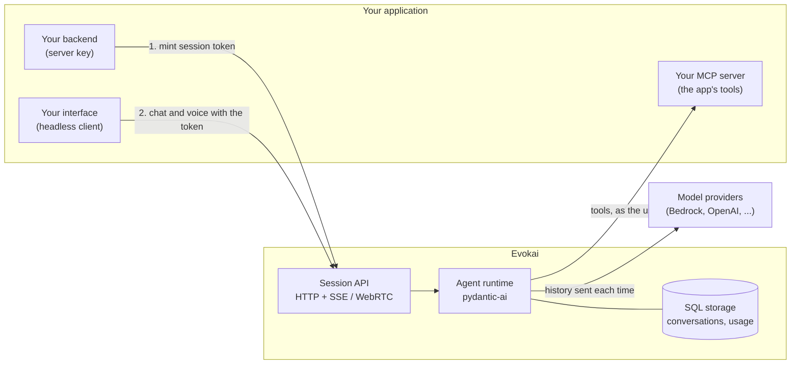

<div align="center">


# Evokai™

**Bring AI into your product: complete, governed, ready to plug in.**<br/>
The agent backend, the chat and voice interface, the admin console, the governance and the monitoring, in one
open-source service. Connect your app with a key, and its users get an assistant that works on their data and their
actions, as themselves, within the limits you set.

[](https://github.com/Giordyfish/evokai/actions/workflows/ci.yml)
[](#status)
[](LICENSE)
[](pyproject.toml)
[](#support-evokai)

[Documentation](https://giordyfish.github.io/evokai/) · [What you get](#what-you-get) · [Governance](#governance-built-in) · [Quick start](#quick-start) · [How it works](#how-it-works) · [Client](#the-typescript-client) · [Guides](#documentation) · [Contributing](#contributing) · [Support](#support-evokai)

</div>

---

## The problem it solves

Every company now wants AI inside its products: an assistant that reads what is on screen, runs the app's own
actions, answers by voice, and works in Slack, Teams or e-mail too. The model is the easy part. What takes months, and
what stops most projects at the security review, is everything around it:

- **whose behalf** the agent acts on, and making sure it can never do more than that person could;
- **what it may touch**: which data, which actions, which models, and asking before it changes anything;
- **what it costs**, with limits that hold for every application and every user;
- **where the data goes**, which providers may see it and what they may keep;
- **proving all of this** to security, legal and the AI Act and GDPR paperwork;
- and then the plumbing: the tool loop, streaming, history, voice turn-taking, an interface, an admin screen, logs.

Each product team rebuilds all of it, differently each time. Evokai is all of it, built once, for every application
you connect.

## What you get

| | |
| --- | --- |
| ⚙️ **The agent backend** | The runtime and the API: model calls with fallbacks, your app's tools over MCP, confirmations, memory, knowledge bases, skills, code execution, voice, streaming with replay after a reconnect. Your app does not run any of it. |
| 💬 **The interface** | `<evokai-chat>`, a launcher and a chat panel with tool activity, charts, confirmations, history, dictation and voice mode, and `<evokai-voice>`, a full-screen voice stage. One HTML tag in your page, themable, with React wrappers. Or a headless client (TypeScript, Python) if you draw your own. |
| 🪄 **The admin console** | A web GUI for everything: applications, agents and their versions, what each app may use, MCP servers, connectors, skills, knowledge, channels, workflows, keys and limits, with a playground to try an agent before it ships. No YAML needed (YAML still works for infrastructure as code). |
| 🛡️ **Governance** | Agents act as the signed-in user, per-app grants, confirmation before changes, hard budgets, data residency, a security layer, evals, SSO with roles and an audit log, compliance packs. [Below](#governance-built-in), in detail. |
| 📊 **Monitoring** | Usage against the caps, as shares, with a forecast, every turn traced step by step, conversations, security events, health of models and tools, the approvals queue and the audit log, all in the console; OpenTelemetry when you want it in your own stack. |
| 🔌 **Integrations** | Your app's MCP server, or ready connectors (SQL, REST from OpenAPI, Google Drive, SharePoint and OneDrive, IMAP). Channels beyond the web: e-mail, Microsoft Teams, Slack. Durable workflows with approvals, schedules and webhooks. Standard endpoints: an OpenAI-compatible API, AG-UI and A2A. |
| 🧠 **Any model** | Amazon Bedrock, Azure OpenAI, Google Vertex AI, OpenAI, Anthropic, Mistral, European clouds (Scaleway, OVHcloud, IONOS, STACKIT), or your own servers through Ollama, vLLM or LM Studio. An allow-list and an ordered fallback chain per agent; switching model is one line. |

<p align="center"></p>

## Governance, built in

Governance is not a plug-in in Evokai: every request goes through it.

- **The agent is the user.** Your tools are called over MCP with the signed-in user's own credential, and filtered
  per user, so an agent can never see or do more than that person. Tools that change data stop the turn and wait for
  the user's confirmation.
- **Each application gets explicit grants**: which models, tools, skills, voice, channels and code
  execution its agents may use, each with its own keys and caps. Anything not granted is off.
- **Budgets that hold.** Hard caps per application and defaults per user, by month and by day, enforced before every
  model call. People only ever see percentages of their allowance, never amounts.
- **Data protection per application.** Data residency (where data may live and models may run), jurisdiction (which
  countries may control a provider) and retention (any, no training, zero retention), applied to every external
  processor: models, embeddings, classifiers, the code sandbox, speech. A provider the catalog cannot prove compliant
  is left out. Nothing is ever stored on the provider side: the history is always sent from Evokai or your app.
- **A security layer** mapped to the OWASP LLM Top 10: prompt-injection and jailbreak checks, tool output and e-mails
  marked as untrusted data, personal data masked or tokenised, secrets and unsafe links stopped in answers, a tool
  policy and abuse limits; each control off, monitored or enforced. A red-team suite tests it on demand.
- **Evals before release.** Test cases per agent run on every new version against the previous one, so a regression
  is caught before it goes live.
- **Accountable operations.** The console uses single sign-on with viewer, operator and owner roles, and every change
  lands in an audit log.
- **Compliance from the real configuration.** AI Act (classification, Annex IV-style documentation), GDPR (record of
  processing, DPIA template, rights, DPA annex) and an ISO 27001 / SOC 2 mapping, generated from what is actually
  configured, every statement with its source, with snapshots and diffs. Personal data can be exported or erased on
  request, with retention per kind of data.

Evokai pays particular attention to the European regulatory space; see [data protection](docs/data-protection.md),
[security](docs/security.md) and [compliance](docs/compliance.md).

## In your app

Three steps, and your users have an assistant:

1. **Connect the app** in the console: it gets a server key, its agent (a model from the allowed list, instructions,
   your MCP server, skills) and its limits. List the web addresses your pages are served from (`http://localhost:3000`
   while you develop) among the application's **allowed origins**: Evokai refuses browsers from any other origin.
2. **Mint a token** from your backend for the signed-in user. The browser calls this route on first use, before the
   token expires and to open another conversation, sending the `conversationId` it wants to continue:

   ```ts
   import { EvokaiServer } from '@evokai/evokai-client/server'

   const evokai = new EvokaiServer({ baseUrl: process.env.EVOKAI_URL!, serverKey: process.env.EVOKAI_SERVER_KEY! })
   app.use(express.json())
   app.post('/api/agent/token', async (req, res) =>
     res.json(await evokai.mintSessionToken({
       subject: req.user.id, // your id for the signed-in user
       agent: 'assistant',
       conversationId: req.body?.conversationId ?? undefined, // omitted = a new conversation
     })))
   ```

3. **Drop the interface** into your page (`npm install @evokai/evokai-ui @evokai/evokai-client`, then register the
   elements once):

   ```html
   <script type="module">
     import { defineElements } from '@evokai/evokai-ui'
     defineElements()
   </script>
   <evokai-chat base-url="http://localhost:8787/agent" token-url="/api/agent/token" title="Ada"></evokai-chat>
   ```

   The bare import needs a bundler (Vite, webpack, Next.js) or an import map; the
   [bookshop example](examples/bookshop-app) serves the built files with an import map and no bundler.

The agent calls your app's tools over MCP as that user, asks before it changes anything, stays within the budgets
you set, and every turn shows up in the console. A complete app is in [examples/bookshop-app](examples/bookshop-app).

## Status

Evokai is **experimental** and early-stage. Interfaces (the HTTP API, the configuration, the clients) may change
between 0.x releases, and a release may need a manual migration step; read the [changelog](CHANGELOG.md) before you
upgrade. Using it in production is at your own risk: the software is provided "as is", without warranties or
conditions of any kind, and without liability, as stated in sections 7 and 8 of the [Apache License 2.0](LICENSE).

The whole list of features, with details: [features](docs/features.md).

## How it works



1. Your backend holds the **server key** and mints a short-lived **session token** for one of its users (an opaque
   `subject`) and an agent.
2. The browser talks to Evokai directly with that token: text over SSE, voice in the browser or over WebRTC.
3. Each turn runs the agent: model calls with fallbacks, your tools through MCP with the user's own credential,
   confirmations, budgets. Events stream back numbered, so a reconnecting client replays what it missed.

## Quick start

Five minutes, with Docker and nothing else ([the whole walk-through](docs/quickstart.md)):

```bash
git clone https://github.com/Giordyfish/evokai && cd evokai
docker compose up -d --build     # Evokai, its console and its own Postgres; keys generated on first start
docker compose logs evokai       # the console address and the operator key, printed once
```

Open `http://localhost:8787/agent/admin/`, enter the operator key, and the console's setup creates your first
application, its agent (a model from the allowed list, its instructions, optionally your MCP server, tested before it
is saved, and skills) and its server key. No YAML. The test model works with no account; pass `OPENAI_API_KEY`,
`MISTRAL_API_KEY`, AWS credentials or `OLLAMA_BASE_URL` for a real one.

From the source tree:

```bash
uv sync --all-extras --dev
uv run evokai migrate
EVOKAI_CONFIG_FILE=config/bookshop.yaml uv run evokai serve   # an example bookshop back office; /agent/health
```

For infrastructure as code, an application is a YAML file applied at start:

```yaml
application:
  slug: acme
  name: Acme
  server_key: "${EVOKAI_ACME_SERVER_KEY}"
  allowed_origins: ["https://app.acme.example"]
  allowed_models: ["bedrock:eu.*"]
  monthly_cap_usd: 20
  subject_daily_usd: 0.5
  conversation_ttl_days: 7

mcp_servers:
  - name: acme
    url: "https://app.acme.example/api/mcp"
    auth: forward_user

agents:
  - name: assistant
    model: eu.anthropic.claude-haiku-4-5-20251001-v1:0
    fallbacks: [eu.anthropic.claude-sonnet-4-6]
    mcp_servers: [acme]
    instructions: |
      You are Acme's assistant. Use the tools; never invent data.
```

## The TypeScript client

[`@evokai/evokai-client`](clients/typescript) is headless: it gives your interface everything it needs and draws
nothing.

```ts
// Backend: mint a token for the signed-in user
import { EvokaiServer } from '@evokai/evokai-client/server'

const evokai = new EvokaiServer({ baseUrl: process.env.EVOKAI_URL!, serverKey: process.env.EVOKAI_SERVER_KEY! })
const token = await evokai.mintSessionToken({ subject: user.id, agent: 'assistant', forwardCredential: user.accessToken })
```

```ts
// Browser: chat, events and voice
import { EvokaiSession, createVoiceEngine } from '@evokai/evokai-client/browser'

const session = new EvokaiSession({
  baseUrl: 'https://agents.example.com/agent',
  // Your token route (above); conversationId continues a conversation, null starts a new one.
  getToken: ({ conversationId }) =>
    fetch('/api/agent/token', {
      method: 'POST',
      headers: { 'Content-Type': 'application/json' },
      body: JSON.stringify({ conversationId }),
    }).then((r) => r.json()),
})
// Your own interface: appendToAnswer, drawChart, askTheUser and showShare are yours.
session.on('text', (e) => appendToAnswer(e.delta))
session.on('chart', (e) => drawChart(e.chart))
// A tool that changes data waits for the person: answer with session.confirm, and the turn goes on.
session.on('confirm', async (e) => session.confirm(e.actionId, await askTheUser(e.items)))
session.on('usage', (u) => showShare(u.dayPct))
await session.chat({ text: 'How did October go?' })

const voice = createVoiceEngine(session, { micSound: 'goccia' }) // dictation, conversation, barge-in
```

| Entry point | Runs in | What it gives you |
| --- | --- | --- |
| `/server` | your backend | session tokens, conversations, usage, server runs, admin API |
| `/browser` | any web app | session and typed events, turn phases, microphone, voice modes, speech engines, audio signals |
| `/react` | React 18+ | thin hooks over `/browser` |

Every export and event is in [API.md](clients/typescript/API.md).

### Ready-made interface

[`@evokai/evokai-ui`](clients/ui) draws it for you: `<evokai-chat>` (a launcher orb and a chat panel with Markdown,
tool activity, charts, questions, confirmations, usage shares, history, feedback, dictation and voice mode) and
`<evokai-voice>` (a full-screen voice stage), as Web Components with React wrappers, themable with CSS custom
properties, in English and Italian.

```html
<evokai-chat base-url="https://agents.example.com/agent" token-url="/api/agent/token" title="Ada"></evokai-chat>
```

## Documentation

The guides are also published as a website: [giordyfish.github.io/evokai](https://giordyfish.github.io/evokai/).

| Guide | What is in it |
| --- | --- |
| [Quick start](docs/quickstart.md) | Docker Compose, the first-run setup in the console, models |
| [Features](docs/features.md) | Everything Evokai does, in one table |
| [Knowledge bases](docs/knowledge.md) | Documents agents search (PDF, Office, HTML, Markdown, CSV), hybrid search with pgvector, access groups, citations |
| [Evals](docs/evals.md) | Test cases per agent, runs on save and on demand, the comparison, the eval budget |
| [Connectors](docs/connectors/README.md) | Ready MCP servers: SQL, REST/OpenAPI, Google Drive, SharePoint and OneDrive, IMAP |
| [Architecture](docs/architecture.md) | Concepts, the protocol, voice, limits, storage and the hard rules |
| [Configuration](docs/configuration.md) | Environment variables, application YAML, bootstrap, keys, time to live |
| [Deployment](docs/deployment.md) | Running it, Docker, database setup, CI gates, images, SBOMs and signing |
| [Security](docs/security.md) | Threat model, the security layer's controls (OWASP LLM Top 10), configuration, events |
| [Data protection](docs/data-protection.md) | The data protection profile: residency, jurisdiction and retention rules for every processor, and the provider catalog |
| [Privacy](docs/privacy.md) | What is stored, where, for how long; export and erase; residency; sub-processors |
| [Compliance](docs/compliance.md) | AI Act, GDPR and ISO 27001 / SOC 2 packs generated from the configuration, with sources, snapshots and diffs |
| [Code execution](docs/code.md) | `code_run`: Python in Amazon Bedrock AgentCore Code Interpreter, isolated, EU region, off until granted |
| [Security assessment](docs/security-assessment.md) | The review of the browser session API, its findings and fixes |
| [AG-UI](docs/ag-ui.md) | The AG-UI endpoint for CopilotKit and other AG-UI frontends; confirmations as interrupts |
| [OpenAI-compatible API](docs/openai-compatible.md) | Chat Completions for openai-python, LangChain and any OpenAI client |
| [A2A](docs/a2a.md) | Agent Cards and JSON-RPC for other agents, off until granted |
| [Client](clients/typescript/README.md) | Installing and using `@evokai/evokai-client` |
| [Python SDK](clients/python/README.md) | The `evokai-client` package (`import evokai`): server SDK, admin, session client with typed events |
| [Releasing](docs/releasing.md) | How a version is tagged and published, and the one-time setup of the registries |

## Project layout

```text
src/evokai/        the service: api, agents, sessions, mcp, llm, tools, audio, identity, db, observability
migrations/        Alembic migrations, portable across SQL databases
clients/typescript the headless client (@evokai/evokai-client)
clients/python     the Python SDK (evokai): server, admin and session clients, sync and async
clients/ui         the embeddable interface (@evokai/evokai-ui): <evokai-chat>, <evokai-voice>, React wrappers
admin/             the admin console (static app served at {base}/admin/)
config/            an example application (a fictional bookshop) with a skill
examples/          a complete app that summons its agent (backend, page, tools)
docs/              architecture, configuration, deployment
scripts/           ci.sh (all gates) and build-image.sh
tests/             pytest, with fake models, MCP servers and speech
```

## Development

```bash
scripts/ci.sh      # ruff, ty, pytest, OpenAPI check, the client, the UI components and the admin console
scripts/quickstart-smoke.sh   # the Docker quick start end to end, as CI runs it
scripts/record-cassettes.sh mcp|bedrock   # opt-in: record the HTTP cassettes the suite replays
```

Tests replay recorded HTTP cassettes and never reach the network
([recorded HTTP cassettes](docs/deployment.md#recorded-http-cassettes)).

## Contributing

This repository is developed with heavy use of AI agents. Work however you like, by hand or with agents: nobody is
asked to use AI, and nobody is asked to avoid it. Complaining that the project is built with AI is not a useful
contribution, though. Every contribution, human or agentic, is welcome as long as it is reasoned, structured and well
described: a problem worth solving, an approach you can explain, and evidence that it works. Unreviewed slop is not.

Read [CONTRIBUTING.md](CONTRIBUTING.md) for the gates, what a good pull request looks like and the DCO sign-off,
[SECURITY.md](SECURITY.md) to report a vulnerability privately, and the [code of conduct](CODE_OF_CONDUCT.md).
Code, comments and docs are in English.

## Support Evokai

Evokai is free and open source, built and maintained independently. If it saves you work, or you would like to see
it grow, you can support it:

- [GitHub Sponsors](https://github.com/sponsors/Giordyfish), monthly or one-off;
- [Ko-fi](https://ko-fi.com/Giordyfish), one-off, also with PayPal.

Starring the repository and telling others about it helps too.

## License

Copyright 2026 Giordano Pescetelli. Licensed under the [Apache License 2.0](LICENSE).

The name **Evokai™**, its logo and its mascot are unregistered trademarks of Giordano Pescetelli and are not covered
by the license (see [NOTICE](NOTICE) and [TRADEMARKS.md](TRADEMARKS.md)): forks and derived works must use their own
name and branding and keep the copyright notices.
