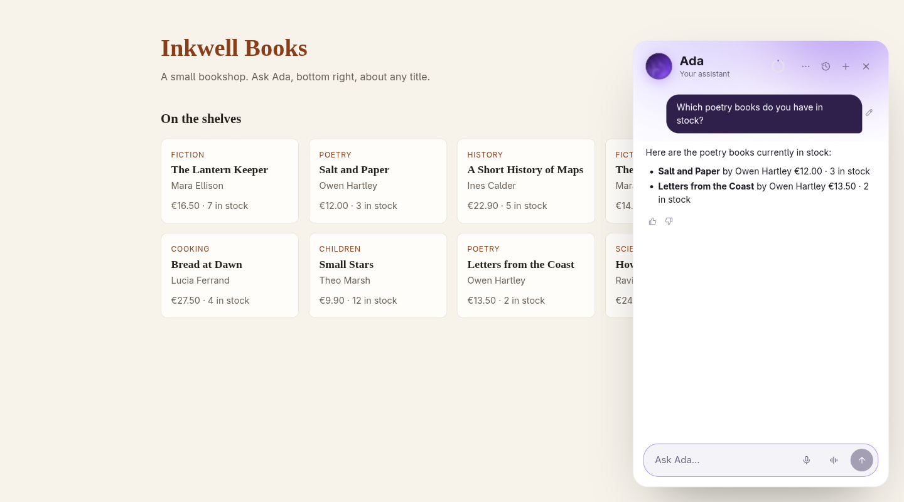

# Inkwell Books: a shop page with its assistant

<p align="center"></p>

A small web app for Inkwell Books, the fictional bookshop of [`config/bookshop.yaml`](../../config/bookshop.yaml),
wired to Evokai the way a real application is:

- the **backend** (`server.mjs`, plain `node:http`) keeps the server key and mints a short session token for the
  signed-in user with [`@evokai/evokai-client/server`](../../clients/typescript/README.md);
- the **page** (`public/index.html`) lists the catalogue and drops in the `<evokai-chat>` panel of
  [`@evokai/evokai-ui`](../../clients/ui/README.md), which talks to Evokai directly with that token;
- the backend is also a tiny **MCP server** (`POST /mcp`, one read-only tool, `catalogue_search`), so the agent reads
  the shop's data through the shop, with a secret Evokai sends on every call.

```text
browser ──(session token)──▶ Evokai ──(MCP, secret)──▶ this app's /mcp
   │                            ▲
   └──▶ this app's /api/agent/token ──(server key)──┘
```

| File | What it is |
| --- | --- |
| `server.mjs` | The page, the token and history routes, the MCP server |
| `setup.mjs` | One-time setup: the application, its MCP server and the agent, then `.env` |
| `catalogue.mjs` | The books, shared by the page and the tool |
| `public/` | The shop page and its stylesheet |

## Run it

You need Node 22 or later and the [quick start](../../docs/quickstart.md) running (Docker, the test model, no
cloud account).

**1. Start Evokai** at the repository root and note the operator key it prints:

```bash
docker compose up -d --build
docker compose logs evokai          # Operator key:  evk_op_...
```

**2. Build the clients.** The example uses the packages of this repository (`file:` references), so it works with
the code you have checked out:

```bash
(cd clients/typescript && npm ci && npm run build)
(cd clients/ui && npm ci && npm run build)
```

**3. Set up and start the app:**

```bash
cd examples/bookshop-app
npm install
EVOKAI_OPERATOR_KEY=evk_op_... npm run setup
npm start                           # http://localhost:3000
```

`npm run setup` creates the application `bookshop` (with `http://localhost:3000` among its allowed origins), registers
this app's MCP server with a new random secret, creates the agent `bookshop` and writes `.env` with the server key and
that secret. The admin key is not kept; the console takes the operator key.

Open `http://localhost:3000`, click the orb at the bottom right and ask something. With the test model the agent
answers with a fixed text, which shows the whole path works: page, token, session, stream.

## With a real model

The test model calls no tools. To see the agent search the catalogue, give it a model that does, for example one on
this machine through Ollama:

```bash
OLLAMA_BASE_URL=http://host.docker.internal:11434/v1 docker compose up -d     # at the repository root
rm .env && EVOKAI_APP_SLUG=bookshop-local EVOKAI_MODEL=ollama:qwen3:8b EVOKAI_OPERATOR_KEY=evk_op_... npm run setup
npm start
```

Ask «Which poetry books do you have in stock?»: the panel shows the `catalogue_search` call, then the answer. Any
model of [docs/quickstart.md](../../docs/quickstart.md#models) works the same way, and the console can change the
agent's model later.

## Settings

| Variable | Default | Meaning |
| --- | --- | --- |
| `EVOKAI_URL` | `http://localhost:8787/agent` | Where Evokai is mounted |
| `EVOKAI_SERVER_KEY` | from `.env` | The application's server key (never sent to the browser) |
| `EVOKAI_AGENT` | `bookshop` | The agent the tokens are minted for |
| `BOOKSHOP_MCP_SECRET` | from `.env` | What Evokai must send to `/mcp`; without it `/mcp` refuses every call |
| `PORT` | `3000` | The app's port (also the allowed origin and the MCP address `setup` registers) |
| `EVOKAI_OPERATOR_KEY` | | Setup only: creates the application |
| `EVOKAI_MODEL` | `test:canned` | Setup only: the agent's model |
| `BOOKSHOP_MCP_URL` | `http://host.docker.internal:3000/mcp` | Setup only: where Evokai reaches `/mcp` (the host, seen from the quick start's container) |
| `EVOKAI_APP_SLUG` | `bookshop` | Setup only: the application's slug |

The variables win over `.env`. The console's setup wizard ([quick start, step 2](../../docs/quickstart.md#2-set-up-your-first-application))
does what `setup.mjs` does by hand: put its server key in `EVOKAI_SERVER_KEY` and its agent's name in `EVOKAI_AGENT`.

## In your own app

- **Users.** `currentUser()` in `server.mjs` returns one demo reader. Take the user from your own sign-in: the
  `subject` is your id for them, opaque to Evokai, and their conversations, caps and memories hang on it.
- **Published packages.** Replace the `file:` references with the releases, then import the browser files from your
  bundler (or keep serving them from `node_modules` as `server.mjs` does):

  ```bash
  npm install @evokai/evokai-client@^0.1.0 @evokai/evokai-ui@^0.1.0
  ```

- **Your own interface.** The panel is optional: `EvokaiSession` from `@evokai/evokai-client/browser` gives the same
  conversation headless, to draw your way ([client README](../../clients/typescript/README.md#plain-javascript-browser)).

## Clean up

```bash
docker compose down -v              # at the repository root: deletes the database and the keys
```
